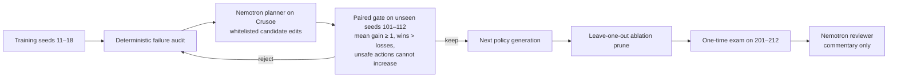

# Factory Autopilot · Version N+1

**A maintenance agent team that changes its own playbook, tools, and roles, then keeps a change only when a paired unseen-run gate proves it helps without making robot work less safe.**

This is the Recursive Agents Hackathon (Crusoe × Cerebral Valley) **Version N+1** entry. The factory is a synthetic six-month digital twin over a real plant-room scan; the product is the self-improving team and its evaluator, not a dashboard.

## Verified result

The recorded Crusoe run and a local deterministic replay agree. The exam split is held out from training and gate decisions (12 seeds: 201–212).

| Exam metric | Team N baseline | Team N+3 learned |
|---|---:|---:|
| Mean score | 66.5 | **92.8** |
| Unsafe robot actions | 21 | **0** |
| Overdue work orders | 25 | **0** |
| Evidence gaps | 46 | **15** |
| Stockouts | 18 | **8** |

The gate kept `verifier_role` (+11.5 mean points, 11 wins/0 losses), `deadline_sweep` (+12.0, 12/0), and `reorder_buffer` (+1.0, 9/3). It rejected `fast_track` because unsafe actions rose from 0 to 15. The final ablation is in [`docs/EVIDENCE.md`](docs/EVIDENCE.md).

## One-minute demo

Watch the recorded walkthrough: [docs/demo-60s.mp4](docs/demo-60s.mp4). Run the same scripted sequence in the browser with [`?demo=1`](http://127.0.0.1:5188/?demo=1): baseline incidents, accepted and rejected generations, leave-one-out ablation, then the learned replay. The browser also continuously sends ROVER-1 to stations through the pilot and can turn a routed camera finding into a work order.

## How the loop learns



The simulator uses common random numbers, so a candidate and its parent face the same incidents. The gate is the evaluator of record: model calls can order the whitelisted edits, but cannot score or approve them. The ablation removes each kept edit from the final policy and retains it only when its removal makes the exam worse or less safe.

## What runs where

- `factory/engine.py` is the deterministic digital twin, audit, gate, prune, and exam.
- `factory/crusoe.py` calls **Crusoe Managed Inference** with `nvidia/NVIDIA-Nemotron-3-Super-120B-A12B` for the planner and reviewer.
- `factory/vision.py` calls Crusoe with `nvidia/NVIDIA-Nemotron-3.5-Super-VL` for camera findings and evidence verification.
- `factory/pilot.py` calls Crusoe with `nvidia/Nemotron-3.5-Lightning-30B-A3B` for bounded `forward`, `back`, `left`, `right`, and `stop` commands from egocentric goal and five-ray free-distance state. The browser rejects obstacle-intersecting moves and falls back to its A* route planner when the pilot is unavailable.
- A routed vision finding opens a work order, pilots an arm to the station, and sends the resulting frame to `/api/verify`; the checked-in CAM-02 verification record is an explicit negative (`arm_on_site: false`), so the evidence path reports an evidence gap instead of claiming a successful closure.
- `factory/server.py` exposes the replay and API. With no key it replays recorded evidence or runs the rule-based auditor; no live call is required for the demo.
- The browser renders a 14.2M-splat plant-room scan and overlays robots, cameras, and work orders. The UI visualizes the team’s decisions; it is not the product’s main feature.

## Run

```bash
python3 -m unittest discover -s factory -p 'test_*.py'
CRUSOE_API_KEY=... python3 -m factory.server
```

Open `http://127.0.0.1:5188`; `?demo=1` plays the scripted one-minute sequence. Secrets are injected with `hsec` for live work and are never stored in the repository.

## Evidence and limitations

- Exact recorded calls, model IDs, split seeds, gate verdicts, and exam numbers: [`docs/EVIDENCE.md`](docs/EVIDENCE.md).
- Architecture and data flow: [`docs/ARCHITECTURE.md`](docs/ARCHITECTURE.md).
- Criterion-by-criterion judging map: [`docs/JUDGING.md`](docs/JUDGING.md).
- The factory is a synthetic simulator over a real scan. Its rates and score gains are modeled evaluator behavior, not claims about a physical plant.
- Vision findings are real recorded model outputs, but they do **not** change the simulator score; the score comes from the deterministic maintenance twin.
- The pilot and vision work-order path is an interactive layer around the twin; its cached verification example is a failed on-site check, not evidence of physical execution or safety.
- The scan is streamed from SuperSplat at runtime and is not bundled here. See the rights note in `factory/README.md`.

## Credits

The scene is SuperSplat scene `8be1404d` (`merged_room_v2_3x`). Navigation and surveyed equipment positions derive from teammate Phylax with permission. Vendored PlayCanvas/SuperSplat components retain their MIT notices.
