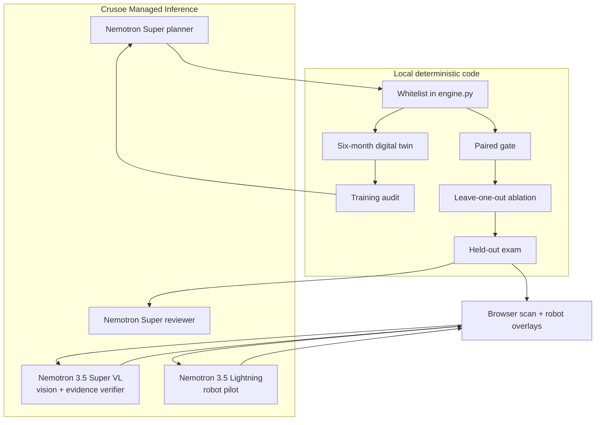

# Architecture

Factory Autopilot separates model choice from measurement. The team may ask Nemotron to rank a small, explicit set of edits; only the deterministic simulator can accept an edit.

The seed splits are fixed and disjoint: training `11–18`, gate `101–112`, exam `201–212`. Each incident consumes the same random draws for parent and candidate policies. A gate rejects a candidate if unsafe actions increase, the mean score gain is below 1.0, or it does not win more paired seeds than it loses. A reviewer receives exam results after selection and writes commentary only.

The HTTP server has three safe modes: live (Crusoe key present), recorded (a checked-in live evidence file replays exactly), and offline (rule-based proposer). `/api/replay` runs a telemetry-rich deterministic six-month run for an exam seed; `/api/detect` and `/api/verify` validate browser frames and call the VL model or replay cached evidence; `/api/pilot` validates state, asks Lightning for up to five commands from a fixed vocabulary, and returns no commands when the response is unusable.

The browser computes five free-distance rays from the scanned floor's walk grid and sends them with goal bearing, goal distance, robot id, and recent commands. It executes turns and moves locally, checking each proposed segment against obstacles; a failed pilot request hands the robot to the existing A* route planner. ROVER-1 patrols the station route continuously. When a VL detection is actionable, the browser opens a work order, pilots an arm to the station, captures a post-work frame, and calls `/api/verify`. The verifier result controls whether the work-order evidence is accepted; the cached CAM-02 record demonstrates the negative path (`arm_on_site: false`).
